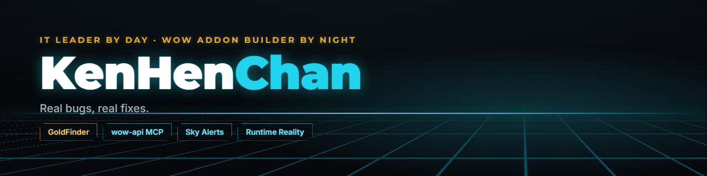

<sub><code>// the weblog of a curious mind</code></sub>

### Notes from a curious engineer.

Hi, I'm **Kenneth Henseler** (Ken), Systems & Platform Engineering · Indianapolis.

Platform engineering, AI systems that misbehave, and the WoW addons I build live on [stream](https://www.twitch.tv/kenhenchan). Plus the history, science and music I can't stop reading about. By day that means SQL Server HA, Nutanix HCI, hybrid cloud, and the automation in between. All of it gets written up at **[musingsofmy.today](https://musingsofmy.today)**.

```text
now.log  ~/kenhen
streaming   twitch.tv/kenhenchan · off for Thanksgiving week
building    daw-agent-skills: Audio DSP forensics for DAW copilots (#2)
latest ep   Runtime Reality S26.E1125
focus       DAW Agent Skills, skyalerts.space & Thanksgiving break
            last updated 2026-11-25
```

#### `// projects`

| Project | What it is | Status |
| --- | --- | --- |
| [**GoldFinder**](https://www.curseforge.com/wow/addons/goldfinder) | Multi-client auction house deal & crafting arbitrage scanner with net profit after the AH cut, Disenchant EV, and Goblin Ledger P&L. Forever, Retail, Classic Era & MoP. · [source](https://github.com/justadakaje/wow-addons) | `shipped · v2.0.3` |
| [**Sky Alerts**](https://skyalerts.space) | Real-time astronomy alerts from the ALeRCE broker (ZTF + Vera C. Rubin/LSST), paired with sky cutouts, observing forecasts, and a weekly plain-English digest. | `live` |
| [**KenHen.Win**](https://kenhen.win) | Local-first Warcraft alt roster poster and chroma-key portrait studio with Battle.net sync and high-DPI canvas exports. Zero-upload, on Cloudflare Workers. · [companion addon](https://github.com/justadakaje/wow-addons/tree/master/addons/KenHenRoster) | `live` |
| [**wow-api MCP**](https://github.com/justadakaje/wow-addons/tree/master/mcp) | Answers WoW: Forever API questions from ForeverProbe's live client captures instead of LLM memory or retail wikis. Required gate across GoldFinder & BiSGearFinder. | `in use` |

All addons are MIT-licensed and [open source](https://github.com/justadakaje/wow-addons). Each one's page says what was tested, on which game build, and what wasn't.

*Retired:* [Adventurer Plates](https://github.com/justadakaje/wow-addons/tree/master/addons/AdventurerPlates), a character card for WoW: Forever. The community built feature-complete alternatives, so it stays up as a reference implementation for Chomp pull-only comms and 3D model rendering.

#### `// writing`

**Featured:** [Velvet Static: From a 2 A.M. Spotify AI Prompt to a 5-Act Neuro-Bass Sequence, Built From My Phone](https://musingsofmy.today/2026/11/19/velvet-static/)

- [Get Used to It? Part 1: The Router in El Dorado and the Myth of Inevitable Outages](https://musingsofmy.today/2026/11/25/get-used-to-it-part-1/) · 🎧 *Runtime Reality* S26.E1125
- [The Patchpocalypse and the Great Tech Cascade: When Machine-Speed Discovery Meets Human-Speed Ops](https://musingsofmy.today/2026/11/25/the-patchpocalypse-and-the-great-tech-cascade/)
- [The Oldest Thing in the Tent: Debugging a 2.5-Billion-Year-Old Rock from an Indiana Medieval Faire](https://musingsofmy.today/2026/11/14/oldest-rock-in-the-tent/) · 🎧 *The Chronos Archive* S26.E1114
- [The Stenbane Question](https://musingsofmy.today/2026/11/12/the-stenbane-question-part-1/), a five-part series

Five lanes on the blog: [engineering](https://musingsofmy.today/section/engineering/) · [history & politics](https://musingsofmy.today/section/history-politics/) · [science & nature](https://musingsofmy.today/section/science-nature/) · [signal](https://musingsofmy.today/section/signal/) (music) · [field notes](https://musingsofmy.today/section/field-notes/) · [all posts](https://musingsofmy.today/archive/) · [RSS](https://musingsofmy.today/rss.xml)

#### `// podcasts`

- 🎧 **[Runtime Reality](https://podcasts.apple.com/us/podcast/runtime-reality/id1887004265)** · tech, infrastructure, AI. Engineering post-mortems in plain English. [Spotify](https://open.spotify.com/show/7dApwSu5skMv03dZHTZEIK)
- 🎧 **[The Chronos Archive](https://podcasts.apple.com/us/podcast/the-chronos-archive/id1831231439)** · history, science. Deep dives where old history collides with modern systems. [Spotify](https://open.spotify.com/show/5ZkuVRGr2KvzQQA2iBwg2k)

#### `// elsewhere`

[Blog](https://musingsofmy.today) · [Twitch](https://www.twitch.tv/kenhenchan) · [YouTube](https://www.youtube.com/@KenHenChan) · [Threads](https://www.threads.com/@kjhenseler) · [Discord](https://discord.gg/AkmBGKPVFQ) · [LinkedIn](https://www.linkedin.com/in/kennethhenseler)

If GoldFinder saves you gold, [sponsoring](https://github.com/sponsors/justadakaje) buys the time to keep testing it properly.

<sub>Real bugs, real fixes.</sub>
