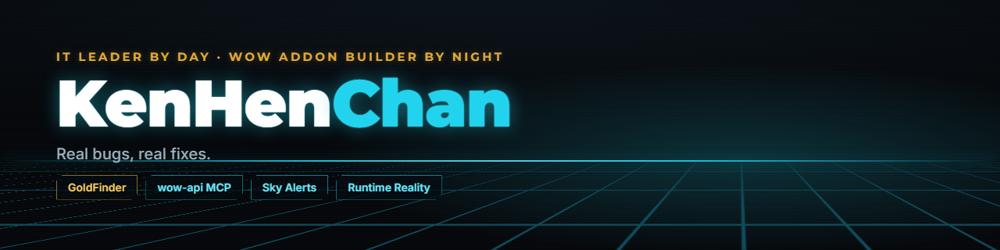

### Hi, I'm Ken.

I lead **systems & platform engineering** by day: SQL Server HA, Nutanix HCI, hybrid cloud, and the automation in between. By night I build **World of Warcraft addons**, live on [Twitch](https://twitch.tv/kenhenchan), and write up what broke.

#### 🛠️ Building

| Project | What it is | Status |
| --- | --- | --- |
| [**GoldFinder**](https://www.curseforge.com/wow/addons/goldfinder) | An auction house tab that finds crafting materials listed well below their usual price, with net profit after the 5% AH cut | `v0.2.0` in the repo · `v0.1.0` on CurseForge · WoW: Forever |
| [**wow-api MCP server**](https://github.com/justadakaje/wow-addons/tree/master/mcp) | Answers WoW: Forever API questions from the live client's API index, not from memory or the wiki | required on every addon here · source in the repo |
| [**Sky Alerts**](https://sky.henseler.app) | Astronomy alerts from ALeRCE (ZTF + Rubin/LSST) → Neon Postgres → Next.js | live |

All addons are MIT-licensed and [open source](https://github.com/justadakaje/wow-addons). Each one's page says what was tested, on which game build, and what wasn't.

*Retired:* [Adventurer Plates](https://github.com/justadakaje/wow-addons/tree/master/addons/AdventurerPlates), a character card for WoW: Forever. The community built feature-complete alternatives, so it stays up as a reference implementation for Chomp pull-only comms and 3D model rendering.

#### ✍️ Writing & audio

- [Confidently Wrong: Four AI Errors a Beta Game Client Caught in Four Hours](https://musingsofmy.today/2026/09/24/ai-confidently-wrong-wow-addon-verification/)
- [Absent from the Docs, Present in the Client: Mapping WoW Forever's Real API Surface](https://musingsofmy.today/2026/09/24/wow-forever-api-surface-build-69913/)
- [The Illusion of Containment: Engineering Lessons from the 2026 AI Sandbox Breaches](https://musingsofmy.today/2026/09/10/ai-sandbox-containment-hugging-face-artifactory-breach/) · 🎧 *Runtime Reality* S26.E0909

#### 📡 Elsewhere

[Twitch](https://twitch.tv/kenhenchan) · [YouTube](https://www.youtube.com/@KenHenChan) · [Blog](https://musingsofmy.today) · [Threads](https://www.threads.com/@kjhenseler) · [LinkedIn](https://www.linkedin.com/in/kennethhenseler)

If GoldFinder saves you gold, [sponsoring](https://github.com/sponsors/justadakaje) buys the time to keep testing it properly.

Real bugs, real fixes.
